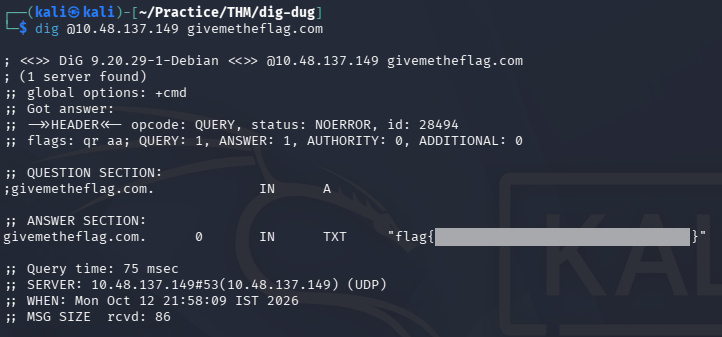

# Dig Dug — TryHackMe Writeup

| Room | Difficulty | Category | Target |
| :--- | :--- | :--- | :--- |
| [Dig Dug](https://tryhackme.com/room/digdug) | Easy | Network / DNS | `10.48.137.149` |

---

## 📖 Overview

The **Dig Dug** challenge on TryHackMe is an easy networking room. This room focuses on DNS enumeration and querying a custom DNS server using the `dig` tool.

---

## 🛠️ Walkthrough

### 1. Host Configuration

We can map the target IP to the domain name locally by editing the `/etc/hosts` file:

```bash
sudo nano /etc/hosts
```

Add the following entry:

```text
10.48.137.149  givemetheflag.com
```

Save and exit the file.

---

### 2. Querying the DNS Server

Use the `dig` command to query the target DNS server directly by prefixing the target IP with `@`:

```bash
dig @10.48.137.149 givemetheflag.com
```

**Command Breakdown:**
- `@10.48.137.149`: Tells `dig` to send the query directly to the target machine's DNS server instead of our default DNS resolver.
- `givemetheflag.com`: The domain name we are requesting information for.

---

### 3. Finding the Flag

The DNS server responds with an **ANSWER SECTION** containing a `TXT` record with the hidden flag:



---

## 🚩 Flag

```text
flag{REDACTED}
```

---