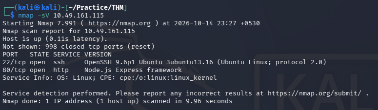
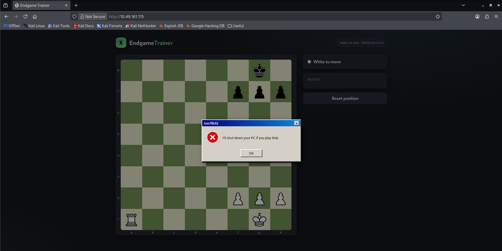
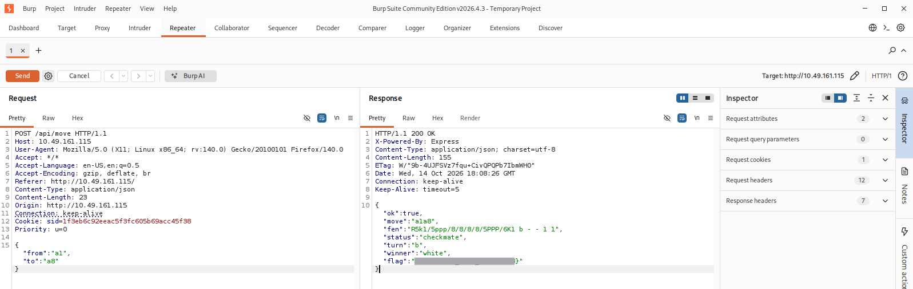

# Fool's Mate — TryHackMe Writeup

| Room | Difficulty | Category | Target |
| :--- | :--- | :--- | :--- |
| [Fools Mate](https://tryhackme.com/room/foolsmate) | Easy | Web / Tampering | `10.49.161.115` |

---

## 📖 Overview

The **Fool's Mate** challenge on TryHackMe is an easy web security room. This room focuses on bypassing client-side validation via request tampering to achieve checkmate and retrieve the flag.

---

## 🛠️ Walkthrough

### 1. Reconnaissance

Run an Nmap service scan to discover open ports and services:

```bash
nmap -sV <TARGET_IP>
```

**Identified Ports:**
- **22/tcp**: Open (SSH)
- **80/tcp**: Open (HTTP)



---

### 2. Web Enumeration

Navigating to `http://<TARGET_IP>` loads an **EndgameTrainer** chess game.

Attempting to move the Rook from `a1` to `a8` for checkmate triggers a client-side error:

> `/usr/lib32: I'll shut down your PC if you play that.`



---

### 3. Exploitation (Request Tampering)

Intercept the move request in **Burp Suite** and modify the destination square to `a8`:

- **Endpoint**: `POST /api/move`
- **Original**: `{"from":"a1","to":"e1"}`
- **Modified**: `{"from":"a1","to":"a8"}`

Forwarding the modified request bypasses the client-side restriction, delivers checkmate, and returns the flag in the response:



---

## 🚩 Flag

```text
THM{REDACTED}
```

---
