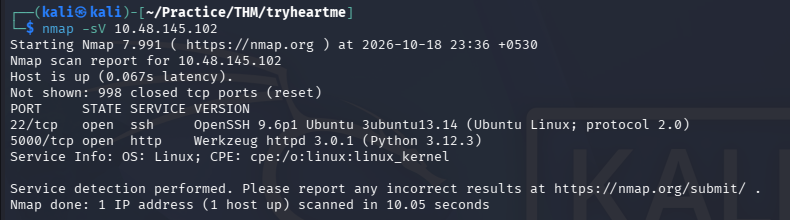
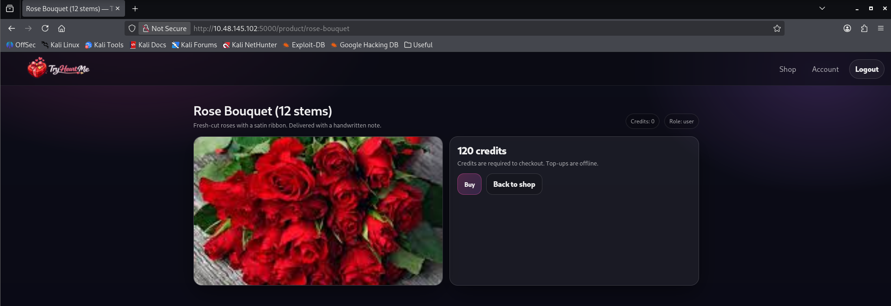
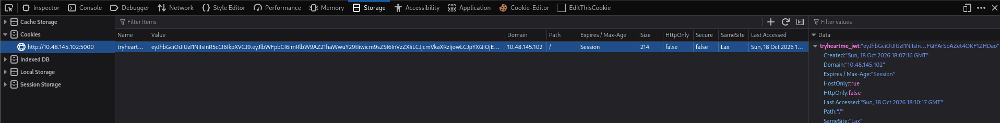
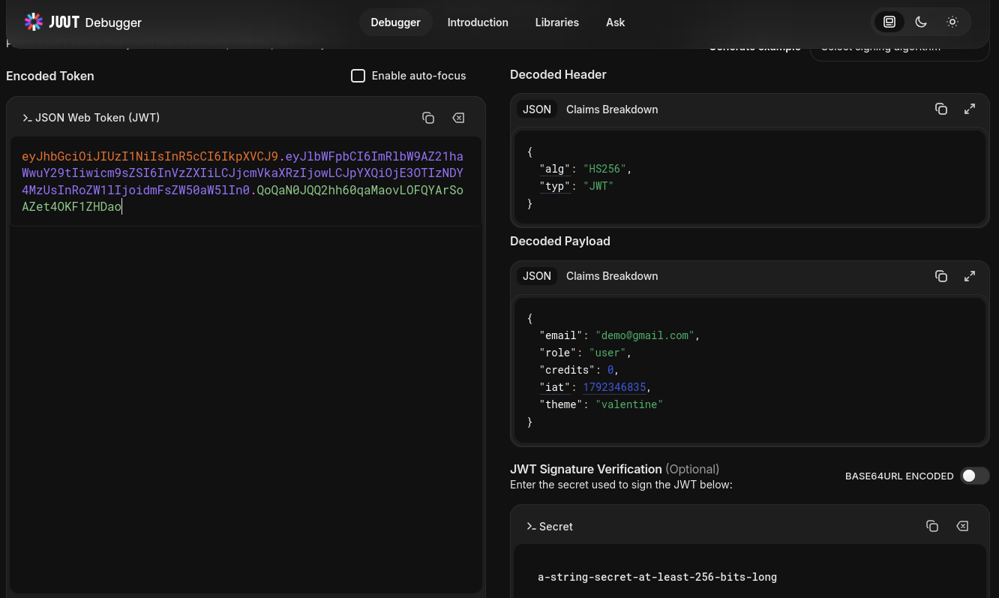
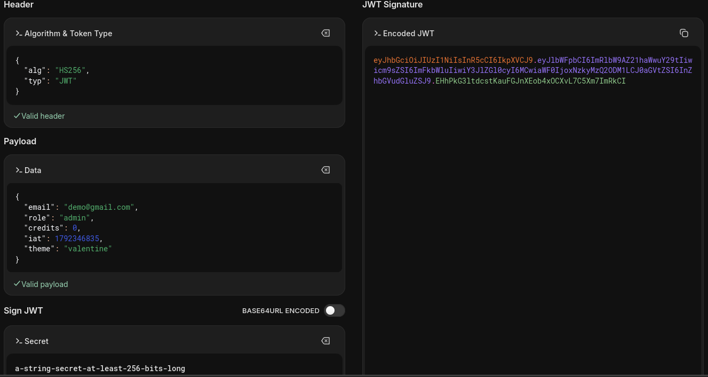
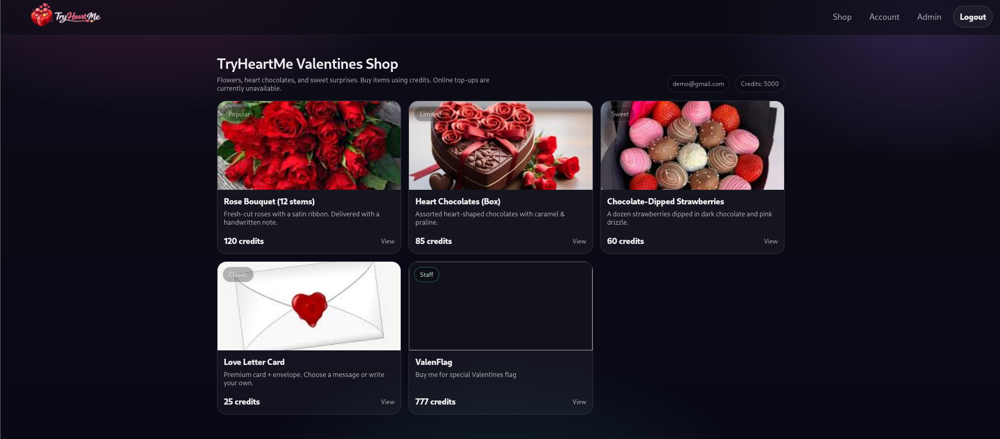
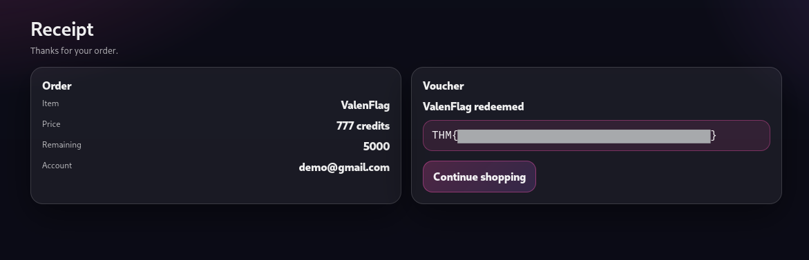

# TryHeartMe — TryHackMe Writeup

| Room | Difficulty | Category | Target |
| :--- | :--- | :--- | :--- |
| [TryHeartMe](https://tryhackme.com/room/lafb2026e5) | Easy | Web / JWT / Broken Access Control | `10.48.145.102` |

---

## 📖 Overview

The **TryHeartMe** challenge on TryHackMe is a Valentine's Day-themed web security room. The objective is to find a way to purchase the restricted **Valenflag** item from the online shop. By inspecting session cookies, identifying client-side JSON Web Token (JWT) handling without strict server-side signature validation, we can tamper with the token payload to escalate our role to `admin`, receive shop credits, and purchase the hidden flag.

---

## 🛠️ Walkthrough

### 1. Reconnaissance

Run an Nmap service scan to discover active services and open ports on the target machine:

```bash
nmap -sV <TARGET_IP>
```

**Identified Ports:**
- **22/tcp**: Open (SSH — OpenSSH 9.6p1)
- **5000/tcp**: Open (HTTP — Werkzeug httpd 3.0.1 / Python 3.12.3)



---

### 2. Web Enumeration & Account Registration

Access the web application at `http://<TARGET_IP>:5000`.

Register a new account (e.g., `demo@gmail.com`) and log in. Once authenticated:
- Clicking on any product reveals the current account status.
- The user starts with `Credits: 0` and `Role: user`.
- Standard users cannot afford or purchase restricted shop items.



---

### 3. Inspecting the Session Cookie

Open browser Developer Tools (`F12`) and navigate to the **Storage** tab -> **Cookies**:

- The application sets an authentication cookie named `tryheartme_jwt`.
- The cookie value has the standard three-part structure of a JSON Web Token (JWT) separated by periods (`header.payload.signature`).



---

### 4. JWT Analysis & Token Tampering

Copy the cookie string and paste it into [jwt.io](https://jwt.io/) to decode the contents.

The decoded token reveals the following claims:

```json
// Header
{
  "alg": "HS256",
  "typ": "JWT"
}

// Payload
{
  "email": "demo@gmail.com",
  "role": "user",
  "credits": 0,
  "iat": 1792346835,
  "theme": "valentine"
}
```



Because the application does not properly verify cryptographic signatures on the backend, modify the payload claims directly in the editor:
- Change `"role": "user"` to `"role": "admin"`.
- Copy the modified, re-encoded JWT string from the debugger.



---

### 5. Privilege Escalation to Admin

Update the session cookie with the forged token:
1. In the browser Developer Tools under **Cookies**, replace the value of `tryheartme_jwt` with the new token.
2. Refresh the page.

The application accepts the modified token:
- An **Admin** navigation option appears in the header.
- The balance updates to `Credits: 5000`.
- The restricted **Valenflag** item (labeled **Staff**) priced at `777 credits` is now accessible.



---

### 6. Purchasing Valenflag & Flag Retrieval

Select the **Valenflag** product and click **Buy now**:

The transaction completes successfully, generating an order receipt that displays the redeemed flag voucher.



---

## 🚩 Flag

```text
THM{REDACTED}
```

---